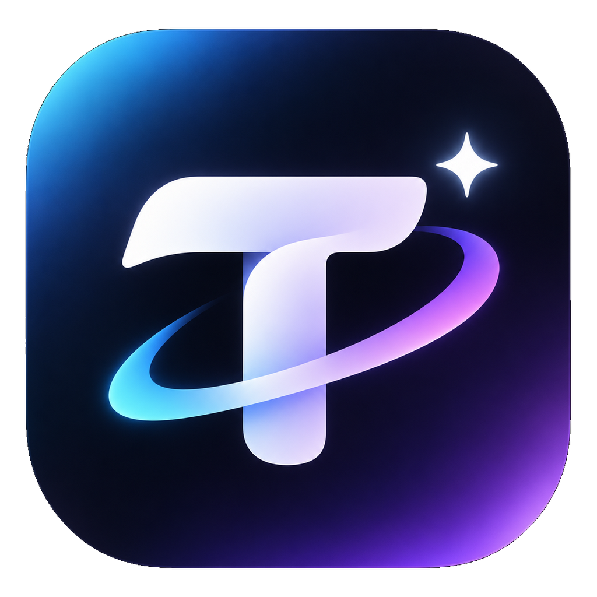
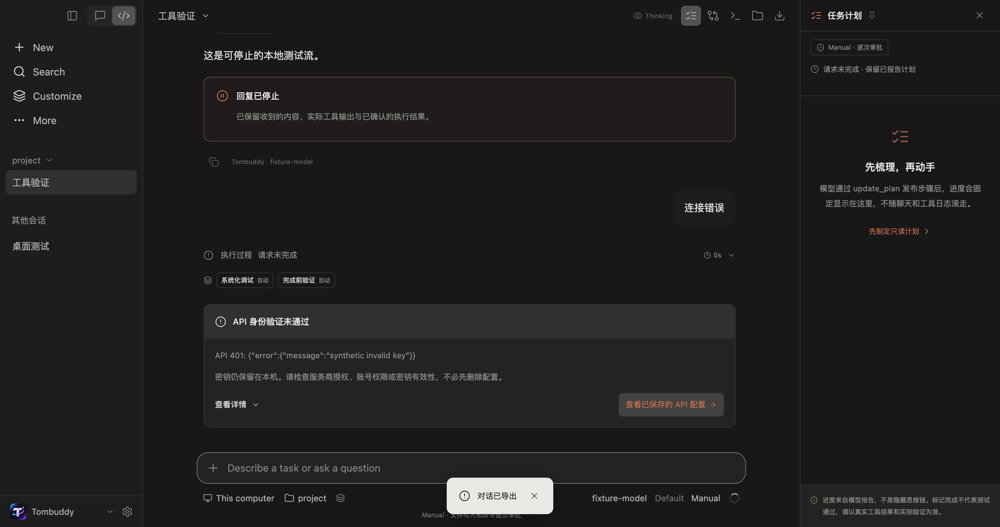
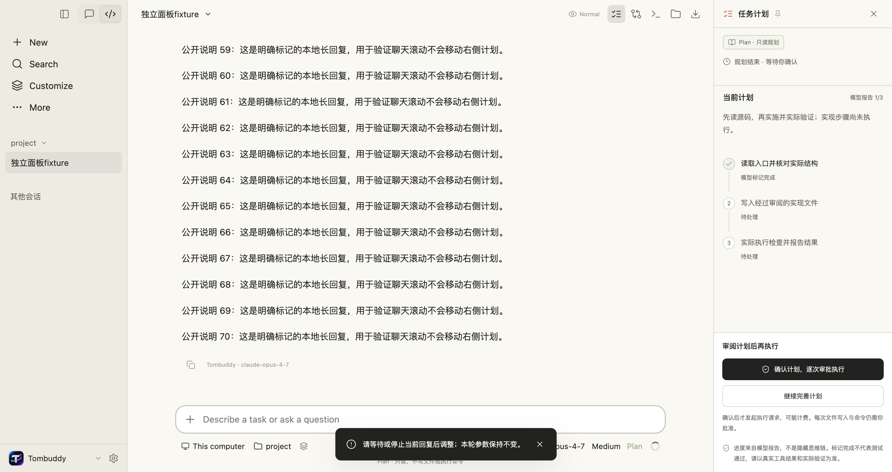
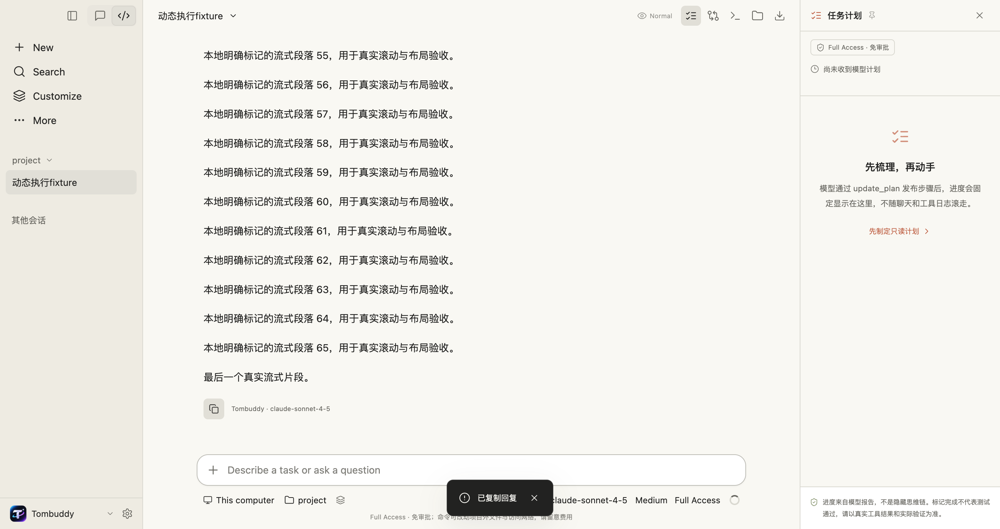
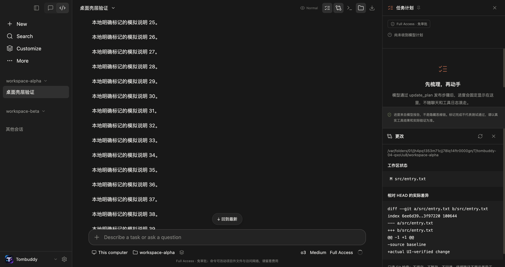
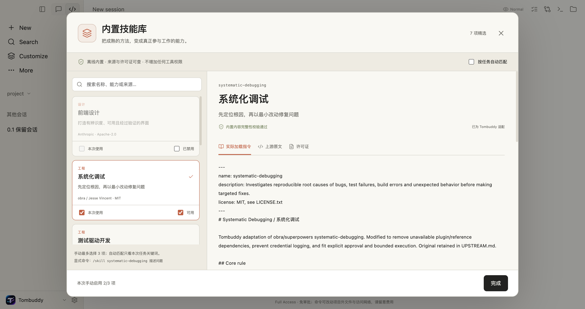
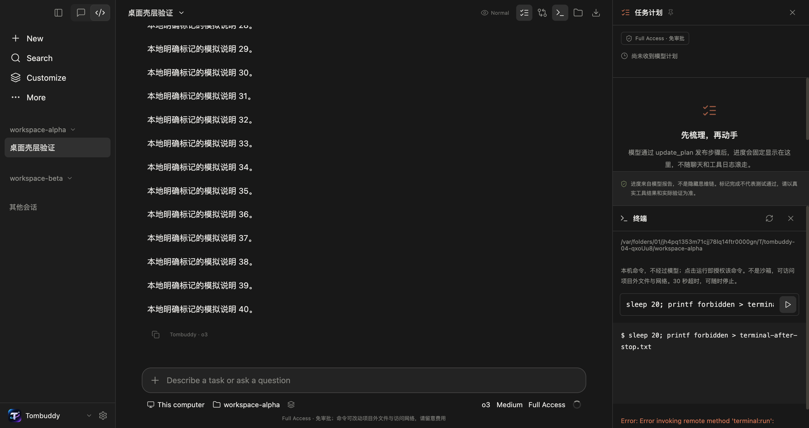

# Tombuddy 0.7.1

本地优先、多模型的 macOS 桌面编码助手。提供 Claude Code 风格的任务工作流、真实推理参数、执行过程和精选内置技能。**独立 Tombuddy 品牌，不是 Anthropic 官方应用，不声称复制 Claude 私有系统、隐藏思维链或保证模型能力一比一相同。**

## 界面预览

<p align="center">
  
</p>

| 深色主题主界面 | Plan 模式：先计划，后执行 |
| --- | --- |
|  |  |
| **按时间顺序的执行记录** | **Git 变更面板** |
|  |  |
| **内置技能库** | **本地终端** |
|  |  |

（截图为 0.6.1 界面；0.7.1 新增的「电脑控制」面板见下方 0.7.1 章节说明。）

## 下载与安装

### Windows（v0.7.1）

到本仓库的 [Releases](https://github.com/Tomhao10225101490/Tombuddy/releases) 页面下载：

- `Tombuddy-0.7.1-win-x64-portable.exe` — **Windows 免安装版**（附 `SHA256SUMS.txt` 校验文件）

**安装/使用方法（免安装版）：**

1. 下载 `Tombuddy-0.7.1-win-x64-portable.exe`，建议放到一个固定文件夹（例如 `D:\Apps\Tombuddy\`），不要放在「下载」里随手删掉。
2. 双击运行。若 Windows SmartScreen 弹出“Windows 已保护你的电脑”，点击 **“更多信息” → “仍要运行”**（本构建未购买代码签名证书，属正常提示）。
3. 首次启动后，在设置里填入你自己的模型服务 API 密钥即可使用；想常驻的话，可右键 exe 选择「固定到任务栏」或发送快捷方式到桌面。
4. 不用了直接删除 exe 即可；你的本地数据保存在本机用户数据目录下的 `state.json`，不会上传到任何服务器。

**Windows 版说明：**

- 与 macOS 版同一套源码；命令执行在 Windows 上走 `cmd.exe`，超时或停止时会终止整个进程树。
- Git 面板调用系统 `git`，请先安装 [Git for Windows](https://git-scm.com/download/win)，否则 Git 面板会提示检查失败（不影响其他功能）。
- **0.7.1 的「电脑控制」（Computer use）目前仅支持 macOS**（依赖 macOS Vision OCR 与辅助功能接口的本地 helper）；Windows 版中该功能会明确提示仅支持 macOS，其余功能不受影响。
- 应用自带 Electron 运行时，无需另装 Node.js；仅支持 64 位 Windows 10/11。

### macOS

见下方「打开」一节（本机安装与项目构建产物）。源码运行：`npm install` 后 `npm run desktop`；打包（含电脑控制 helper 编译）：`npm run pack`。

## 打开

- 本机安装：`/Users/a1/Applications/Tombuddy.app`
- 项目构建：`release/mac-arm64/Tombuddy.app`
- Apple Silicon 压缩包：`release/Tombuddy-0.7.1-mac-arm64.zip`
- 校验值：`artifacts/SHA256SUMS-0.7.1.txt`

```sh
open ~/Applications/Tombuddy.app
```

此构建未做 Apple Developer 签名/公证，仅在当前 Apple Silicon Mac 上验证。跨电脑分发需要正式签名与公证，不要全局关闭 Gatekeeper。旧版应用保留在 `release/backups/`；升级前用户数据备份保留在实际用户数据目录的 `state.before-0.*-*.json`（0600），不复制进项目或安装包。

## 0.7.1 Computer use · Agent 本地感知，不依赖主模型视觉

电脑控制是 Agent 的能力，不要求主模型支持图片输入：**本机截图 → 本机 macOS Vision 中英文 OCR + 辅助功能控件 → 文字化观察/目标 ID → 模型决策 → 本地执行 → 再观察验证**。无额外视觉 API、服务密钥或模型下载。现有纯文本模型可直接接收观察结果，不需要更换为视觉模型。

工具协议默认「自动」：开启电脑控制后，在第一次请求前直接选用**通用文本工具协议**，不发送 `tools` 字段、不探测服务商、不因失败自动重试；普通编码保持原生工具调用。模型服务设置也可显式选择「原生」或「文本」。文本模式用严格、完整的 `<tombuddy_tool_calls>` 封套执行工具，半截/无效/不可用工具请求不会执行，仍执行 Plan/审批/停止检查。只支持普通聊天的模型接口也可以请求电脑工具；模型仍需遵循指令与正确的 API 聊天协议，不能保证任意模型的任务质量。

窗口右上角 **「电脑控制」** → 开启。系统设置 → 隐私与安全性中，按需授权 **辅助功能** 和 **屏幕录制**；授权后可能需要重启应用并重新开启。控制开关仅保存在当前进程内存，重启默认关闭，不偷偷恢复桌面访问。

- `computer_inspect`：当前/指定 bundle ID 应用、最多 160 个辅助功能节点（含坐标），不读取安全文本框的值；指定应用可在后台读取而不抢焦点。
- `computer_observe` / `computer_screenshot`：真实显示器截图在**本地**由 macOS Vision OCR 识别，返回文字、可信度、坐标与 `observationId` / `targetId`。默认只向 API 发送这些**文字**，截图仅作本地临时预览，不写入会话文件。
- `computer_action` 可用 `observationId` + `targetId` 定位，Agent 自动解析坐标/目标应用并在审批中显示来源；任一输入后或两分钟后目标失效。观察期间前台应用/窗口变动会报错，执行前恢复焦点并核对 PID/窗口身份和位置，变化则取消。OCR 目标限制在前台窗口范围，避免误认背景窗口。
- `computer_action`：应用启动/切换、鼠标移动/左右键/双击、拖拽、水平/垂直滚动、Unicode 输入、按键及 Command/Option/Control/Shift 组合。输入必须指定目标应用 bundle ID；批准后先恢复目标应用焦点。`type.replaceAll` 将全选与替换放在同一次审批中，避免切换审批窗口丢失选区。输入不使用/替换用户剪贴板。
- **每次电脑输入逐次批准，即使 Full Access 也不例外**；Plan 仅允许查看。审批完整展示操作意图与参数，拒绝/超时不执行。截图与应用内容是不可信数据，不得当成新指令。
- **紧急停止：⌘⌥⇧Esc**，或顶部「紧急停止」按钮。撤销开关并停止所有当前任务。快捷键注册失败会在面板明确提示；中断后尝试释放鼠标/修饰键。已发送的输入不可撤回，需核对真实状态。

可在 Chat 中不选目录进行电脑任务；Code 模式保留项目目录要求。示例：`打开 Tom Music，查看当前页面，使用 ⌘F 搜索资料库；每次操作后检查真实结果，不修改我的音乐。`

**隐私与边界**：启用需要原生确认对话框。屏幕、应用文本可能包含项目外私人信息，会发送到当前模型服务商；请先关闭敏感窗口。**默认不发送图片，现有 `deepseek-flash` 无需支持图像也能使用 OCR / 控件文字。** 模型服务里可显式开启原始截图增强，只有这个可选项要求模型接收图片，文本协议始终不发送图片。OCR 可能漏字，不能完整理解图标、照片、画布或其他无文字语义，不会假装识别成功。未发送新的付费模型测试请求。不能绕过 TCC、密码、安全输入、系统保护或自动获得 root；无法保证任意应用的每个控件都可操作。CGEvent 成功派发不等于任务成功，必须截图/读取真实状态验证。

无新增第三方依赖：随包本地 Objective-C helper + macOS Vision / AX / CGEvent + Electron desktopCapturer。`npm run pack` 自动编译 helper。`npm test` 验证观察/目标有效期/文本协议/三种 API 传输；`npm run test:computer:text` 使用明确拒绝图片的接口，跨 OpenAI/Anthropic/Gemini 与 native/text/auto 模式，操作一个 AX 中没有文字、必须由真正 OCR 识别的自绘控件；`npm run test:computer` 保留可选视觉传输、原生输入/停止/Plan 验收；`npm run test:music` 在实际 Tom Music 构建的隔离资料库上用 native/text 两种模式验证 ⌘F / Esc。**模型决策为 synthetic loopback；OCR、截图、AX、输入是真实本机操作，不是未执行的云端模型自治测试**。详见 `COMPUTER-USE-071.md`。

## 0.6.1 用户提供的新 logo

应用图标改用你提供的蓝紫渐变 **T 字＋星环＋星光**原图。Dock、macOS 原生 ICNS、侧栏、欢迎页和设置页统一使用同一图像；首页动态宠物保留。

原图逐字节保存在 `build/brand-master.png`，不修改外部原文件、不重绘图形。生成时仅去掉与画布边界相连的近黑色外底并调整 macOS 留白，保留图标内部深色区域；SVG 使用内嵌 PNG，不请求远程图片。检查点及来源哈希见 `LOGO-0.6.1.md`。本版不改 Agent 行为、权限或模型服务；先前 Agent 分层方案仍待后续实现和真实模型评测。

- 当前资源：`public/icon.svg`（本地 PNG 包装）、`public/icon.png`（1024px）、`build/icon.icns`。
- `npm run icon` 从受 SHA-256 校验的本地原 PNG 生成各尺寸；`npm run pack` 自动执行，无需访问外部原文件或网络。

## 0.6 首页动态小伙伴

Code 首页文件夹卡片上方现在是独立的像素小宠物，不是把应用 logo 做成旋转动画。根据本机 Claude Code 的可见形态与睡眠／走动行为自行绘制和实现：

- 眨眼、轻微起伏、沿卡片顶端短距离走动，眼睛看向附近鼠标。
- 本地闲置 30 秒后睡觉，显示浮动 Z；点击、Enter／Space 或重新操作可唤醒，打招呼有短促弹跳。
- 窗口隐藏／最小化或元素不可见时暂停；切换 Chat／Code 时清理并重建监听，不累积后台动画。遵循系统减少动态效果，保留静态睡醒状态和键盘交互。
- 纯本地 UI，不调用模型、不创建任务、不影响文件夹选择。宠物与应用图标分开，品牌名称仍是 Tombuddy。

已经对照本机可观察行为；不声称复制官方私有动画源码、随机种子或所有精确时序。真实帧／位置差异、眼神、原生窗口隐藏、减少动态效果、键盘／点击、反复切页清理、窄窗口和重启有专门验收；自动睡眠验收使用明确的 Playwright 分帧时间加速；最终还正常打开已安装程序，实际闲置 34 秒观察睡眠，再用系统鼠标点击确认唤醒和弹跳（真实资料截图仅留 `/tmp`）。

## 历史 0.6 图标（已被 0.6.1 原图替换）

0.6 使用过自行绘制的白色十二芒太阳（#ffffff）＋暖陶土橙底色（#c15f3c）。这是历史配色，不是当前 logo；其原安装包和升级备份保留，当前资源路径均已换成用户提供的 T 字星环图像。Tombuddy 是独立品牌，不表示官方或政党关联。
- 验收实际安装包里的十二道光芒、中心/底色/透明角像素、原生 ICNS 和已加载的界面图片，而非只检查源文件。

## 0.5 动态交互

- 思考摘要、流式正文、工具卡片按实际事件顺序穿插，保留工具前后的说明，不再将所有工具与正文分别堆在一起。旧会话缺少顺序数据时明确显示为历史记录，不编造顺序。
- 实际请求阶段／执行状态和真实用时；用户手动展开或折叠后，后续 token 不会强制重新展开。
- 命令卡片实时显示有上限的真实 stdout/stderr（UTF-8 分片正确解码，80ms 合并进度避免 IPC 洪泛）；非零退出、超时或输出截断不标记成功。保留 30 秒命令超时／进程组停止。
- 文件工具显示实际原文／新文的带行号增删预览（文本最大 100 KB，展示最多 400 行；无法预览时明说）。Manual 是会话内的真实审批卡片，可以拒绝或仅批准本次；输入区可定位待审批操作，不再强制遮挡全窗口。Full 和 Plan 语义不变。
- 实际文字流期间显示光标；向上阅读时不被新输出拉走，提供回到最新。任务运行中可编辑草稿，Enter 会提示保留草稿，不会静默丢失或自动追加付费请求。尚未实现队列／实时转向。
- 停止后保留部分输出；同批工具中已成功的写入与未确认／未执行的命令分别保存，签名工具调用具有对应结果，支持重启后明确点击继续。不会自动重试或悄悄重复完成的工具。
- 结构化错误卡片、可展开诊断详情、用户明确手动恢复；动画遵循系统减少动态效果设置。

本机参考应用仍有网关错误；只查看已有失败会话，未发送／重试／检查连接。已对照可观察的错误卡片与公共工作流实现，但成功任务的全部官方动态细节、像素与时序尚不能逐项验证，**不声称已经实现一比一全部动态／私有引擎复刻**。新增验收使用 8 个明确标注的 loopback 请求，并实际执行隔离项目中的文件、命令、剪贴板、停止、恢复与重启流程，未消耗真实 API 请求。

## 对照本机 Claude Desktop Code 的界面

0.4 根据本机 `/Applications/Claude.app` 5.11492.5 的可见 Code 页面、模型菜单和原生可访问性坐标重做，不再使用旧版营销欢迎页布局：

- 200px 紧凑侧栏、44px 顶栏、左上 Chat / Code 图标切换、New / Search / Customize / More。
- Code 默认启动；按项目分组的会话，可折叠、重命名、导出或删除，项目内可新建会话。
- 居中的本地文件夹选择卡、底部单行自动增高输入框，独立的环境 / 目录 / 模型 / Effort / 权限 / 实际用量工具栏；模型菜单也能进入 Effort。
- 顶部文件、Git 更改、终端是真实本机能力，不是占位按钮。文件支持目录导航和只读预览；Git 检查不修改仓库、不执行外部 diff/textconv/hooks；终端为用户明确输入的单条命令，30 秒上限、可停止，与模型任务互斥。
- 右侧计划独立于聊天滚动；文件/终端面板打开时共享固定右栏，不遮挡输入区。
- `+` 添加菜单可通过原生选择框添加 UTF-8 文本/代码附件（最多 5 个，每个 100 KB、合计 300 KB），有移除按钮，点击发送后才交给模型；受保护凭据路径、二进制/图片/PDF 不伪装成已支持。
- ⌘ B 侧栏、⌘ J 终端、⌘⇧P 命令面板、⌘⌥← / → 切换 Chat / Code；菜单支持上下方向键、Enter、Escape 和焦点恢复。

保留 Tombuddy 名称、自有 UI 代码与真实权限语义，不复制官方应用源码、专有字体/素材、私有提示词或引擎。不声称全部像素/功能 100% 一致；没有将官方云端、SSH、Worktree、MCP 或专属能力做成假按钮。本机参考应用已有网关错误，未点击重试/检查连接，也未修改其 API 配置或会话内容。参考截图可能含私人历史，只保留在 `/tmp`，不进入项目或发布包。

## 已导入的 DeepSeek 配置

用户明确授权后，从本机 CC Switch 的 DeepSeek 配置只读导入到 Tombuddy；没有切换或修改 CC Switch 服务。

- 服务名称：`DeepSeek（CC Switch）`
- 协议：Anthropic 兼容
- 根地址：`https://api.deepseek.com/anthropic`
- 模型：`deepseek-flash`
- 源配置未指定模型，因此依据 DeepSeek 官方兼容文档选择 Flash，没有使用更高价格的 `claude-opus*` 映射。
- API Key 仅在本机加密保存，没有输出到聊天、截图或普通日志。

**先前单独授权的真实连接验收只有 1 次请求**：模型返回 `OK`，约 0.6 秒；API 报告输入 46 tokens、输出 2 tokens。请求输出上限 256，低推理强度，无项目工具，无自动重试。这个极短请求没有返回公开推理摘要，验证的是接入可用性，不是复杂任务推理质量。证据在 `artifacts/deepseek-live-attempt.json` 和 `artifacts/deepseek-live-result.png`。

导入/测试脚本 `scripts/import-ccswitch-deepseek.cjs` 要求显式授权参数，并在已有真实尝试标记时拒绝再次请求。不要删除标记来绕过授权；额外计费验证需要新的用户授权。

## 开始使用

1. 可直接选择已导入的 DeepSeek，或进入「设置 → 模型服务 → 添加模型服务」配置其他 API。
2. 模型 ID、密钥、根地址与推理协议都可编辑。Base URL 填版本根路径，不要附加 `/messages` 或 `/chat/completions`。
3. 聊天框选择实际模型支持的思考档位与 Full Access / Manual / Plan。新对话默认 **Full Access（免逐次审批）**。较复杂任务可先用 `/plan 任务`，在右侧固定计划面板审阅后确认执行。
4. 「代码」模式先选择项目。文件工具限制在项目内，默认写文件和终端命令免审批。终端并非沙箱，可改动当前用户能访问的项目外文件、访问网络并产生费用；可主动切换 Manual 恢复逐次审批。
5. 侧栏 Customize（技能库）查看技能、来源、许可证，选择本次使用或全局禁用；More 可打开本地项目与设置。

支持 OpenAI 兼容、Anthropic 原生、Gemini 原生，预设覆盖 OpenAI、Anthropic、Gemini、DeepSeek、通义千问、硅基流动、OpenRouter、Ollama 和自定义服务。模型是否存在、余额和账号权限由服务商决定。远程 API 必须 HTTPS；HTTP 仅允许回环地址。请求拒绝自动跳转，避免向重定向目的地泄漏自定义认证头。

「测试连接」会明确询问费用授权后发送 **1 次** 无工具最小请求，请求输出上限 256 tokens，不自动重试。服务商可能另计推理 token，或按自己的规则处理上限；它不是绝对费用保证。测试进行时可停止，已处理的部分仍可能计费。

## 固定计划与 Claude 风格公开交互

- 右侧任务面板独立于聊天滚动，标题、状态与确认区固定，步骤区域自行滚动；长回复和工具输出不会把计划刷走。可以收起，显示偏好及当前计划随会话恢复。
- Plan 只读分析并通过 `update_plan` 发布公开步骤；完成后可确认执行或继续完善。默认「确认计划，免审批执行」进入 Full Access；若先选择 Manual 再规划，则确认后仍逐次审批。确认前不会自动执行；继续完善只填写输入框，不偷偷调用 API。
- Normal：折叠工具；Thinking：展示 API 实际返回的推理摘要、工具仍折叠；Verbose：展开真实工具记录和摘要。显示模式不改变模型推理参数，不自动调用模型或制造思维链。
- `/effort` 打开思考控制；`/effort low|medium|high|xhigh|max` 只接受当前模型实际支持的档位。Enter 保存此模型默认，S /「仅本会话」不改变模型默认；Max 始终仅本会话，新对话不会继承 Max。Auto 不发送 effort（固定预算模型使用默认预算），并清除保存的模型默认；新对话恢复该模型的推荐默认。
- ⌘⇧E 思考菜单、⌘⇧M 权限菜单、⌘⇧I 模型菜单、Ctrl+O 切换显示、Option+T 切换可关闭模型的思考、Esc 关闭菜单或停止回复。运行中参数保持不变，不能通过快捷键偷偷改变正在进行的工具轮次。
- 依据 Claude Code 官方 model-config / desktop / permission-modes 的公开文档适配，不是官方 Claude Code 引擎或像素级保证。**不能复制私有提示词、内部调度或完整隐藏思维链；同名档位不意味着 DeepSeek 与 Claude 的推理相同。** Full Access 是真实免审批执行，不是伪造的 Auto 安全分类器；不会因此获得 root、绕过 macOS 授权或取消模型服务商本身的限制。

## 推理与任务过程

- **按模型显示实际档位**：新 Claude adaptive 型号提供 Low / Medium / High / XHigh / Max 的适用子集；Claude 4.6 不显示 XHigh；不能关闭思考的型号会锁定开关。旧 Claude 固定预算模式明确标出预算映射，不冒充原生 effort。
- **DeepSeek 为 Low / High / Max**：Medium、XHigh 在服务端只会映射成 High，不包装成不同能力。推荐默认 Low，保留思考，降低推理占满正文额度的风险；需要更深分析可主动选 High / Max。
- 档位、开关和费用提示对应真正 API 参数，不是伪造「正在思考」。服务商是否支持和实际返回量仍由模型决定。
- Anthropic：旧型号手动 `budget_tokens`；支持的新型号用 adaptive thinking 与 effort，预算严格小于输出上限。
- DeepSeek Anthropic 兼容：使用 `thinking` + `output_config.effort`，**不伪称 DeepSeek 会执行它实际上忽略的 Claude `budget_tokens`**。
- OpenAI：已知推理模型使用 `reasoning_effort`。DeepSeek OpenAI、Qwen、OpenRouter 有各自可选协议。
- Gemini 2.5：thinkingBudget + includeThoughts；Gemini 3：thinkingLevel + includeThoughts。部分型号两档映射相同，不保证更高档一定增加实际思考。
- 自动识别不了的模型不会盲发参数，会明确提示只使用更严谨的任务工作流；可在模型服务中指定协议。不支持时显示错误，不会静默降级或自动重复计费。
- **执行过程**显示真实请求轮次、工具事件、审批、时间与 API 实际报告的 token。没有返回的用量不会补成假数字；不提供未经验证的费用估算。
- **任务计划**来自模型的 `update_plan` 工具，包含公开的步骤/进展摘要。模型标记完成不代表测试已经通过；工具输出才是验证证据。
- 只显示 API 真正返回的公开推理/摘要；服务不返回时不会补写。不会提取或重建 Claude 私有思维链。
- 保留 Anthropic 的完整签名/安全删减块、Gemini 原始签名 parts、DeepSeek 工具调用所需 reasoning_content，支持多轮工具和重启。换服务、地址、模型或重新保存密钥会隔离旧的签名上下文，避免跨账号重放。
- 应用关闭后中断的回复在恢复时标记「未确认完成」，不会冒充成功。完整签名上下文仅用于已完整完成的轮次；输出上限截断的工具参数绝不会执行，不回放半截 thinking-only 签名块。

### API「断开」修复

0.2 实际记录中的两次失败分别是推理耗尽输出额度、用完 12 轮任务额度，密钥没有丢失。0.3 将它们改为保留进度的暂停，提供手动继续，不再把所有错误都引向重填 API Key。**0.3.1 已按用户要求移除 12 轮工具调用上限**，正常工具任务连续执行到模型完成、用户停止或真实错误，不再每批手动继续。旧暂停仍可恢复；服务商输出/上下文上限、余额、请求超时仍客观存在，不能承诺无限上下文或任何任务必定完成。没有自动网络重试或自动输出额度续费。持续执行会持续消耗 API 用量，请留意费用并随时停止。

鉴权、余额、限流、服务器故障、网络断流、超时和协议异常分别提示。流式缺少完成标记不能冒充成功，未完整确认的工具不执行；遇到明确完成标记立即结束，不被代理遗留连接拖到超时。API 不自动重试、不静默换模型或降级。配置保留、空 Key 编辑保留原密钥，模型选择持久化；同一配置目录禁止重复实例并发覆盖，退出时有界刷新最新会话。技能库加载失败不会阻止模型配置加载或会话保存。

### 只读规划

不是仅在提示词里说「不要写」。主进程不给模型写入/终端工具，并且即使模型强行返回这些调用，也会拒绝执行。可使用目录读取、文件读取和公开计划更新。Full Access 默认免审批；Manual 文件写入与终端命令仍逐次审批。技能不能改变选定权限。Tombuddy 不添加 Claude Code / Codex 品牌专属任务类型过滤；服务商的模型拒答、权限与条款不由客户端控制。

## 七项内置技能

- **前端设计**：基于 Anthropic frontend-design（Apache-2.0）适配。
- **系统化调试**：基于 obra/superpowers systematic-debugging（MIT）。
- **测试驱动开发**：基于 test-driven-development（MIT）。
- **任务规划**：基于 writing-plans（MIT）。
- **需求探索**：基于 brainstorming（MIT）。
- **完成前验证**：基于 verification-before-completion（MIT）。
- **代码与安全审查**：Tombuddy 原创（MIT）。

这些是从可靠公开项目中审查、精选的工作流，不宣称客观意义上的「市场最强」，也不等于安装了整个 Superpowers 插件生态。所有技能随应用离线打包，不含上游可执行脚本、隐式安装器或后台更新。适配版移除了 Tombuddy 不具备的子代理/工作树/浏览器依赖，避免自动删除用户代码，保留审批和验证边界。只加载适配版，上游原文只供查看。

- 自动匹配是透明的关键词规则，只看本次任务；可全局关闭。
- 可手动选择最多 3 项；以「自动 / 手动」标签展示实际加载结果。
- 可显式调用：`/skill systematic-debugging 描述你的问题`。
- 显式 slash 命令优先于手动选择，超出上限会警告。全局禁用的技能不会被自动或 slash 绕过。
- 技能库可查实际加载指令、上游原文、完整许可证、固定提交版本和 SHA-256；完整性不符时拒绝加载。
- 技能指令会随模型请求发送给所选服务商。技能只提供方法，不增设工具权限，不保证模型质量。
- 详细来源和改动说明：`THIRD-PARTY-NOTICES.md`；内容：`skills/`；构建清单：`skills/manifest.json`。

## 已有功能

对话 / Code 模式、项目侧栏、流式 Markdown、代码复制、停止生成、文件浏览/读取/写入、终端执行、会话保存/搜索/删除/Markdown 导出、重启恢复、明暗主题。⌘ N 新对话，⌘ K 搜索，Enter 发送，Shift Enter 换行。

## 数据与权限

- Electron renderer 开启 contextIsolation、sandbox，禁用 Node，API 与文件操作通过限定 preload IPC 交给主进程。
- API Key 通过 Electron safeStorage 使用系统安全机制加密。系统加密不可用时拒绝保存新密钥。前端不会收到已保存的密钥。
- 本机数据在 `~/Library/Application Support/tombuddy/state.json`，权限 0600。**会话、工具输出、返回的推理摘要与签名上下文本身不是整体加密数据库**；请使用系统磁盘加密保护本机。
- 数据无法解析时先建立私有 recovery 备份并提示；权限错误则停止启动，避免静默覆盖。
- 仅本机 `diagnostics.jsonl` 保存有限长度的请求状态、诊断码、轮次与请求 ID 元数据，超过约 256 KB 轮转一份备份；不记录提示词、模型输出、工具结果或密钥。不上传，无后台探活请求。
- 无应用遥测。云端调用会发送当前对话、激活技能和模型通过工具读取的文件内容。选项目不会预先把全仓库上传。
- 自动列目录省略隐藏文件与 node_modules；读文件上限 100 KB，写文件上限 1 MB；阻止路径穿越、目录外符号链接、`.env*`、`.git`、`.ssh` 等凭据/元数据路径。这不是全仓库秘密扫描器。
- **终端不是沙箱**：Full Access 直接以你的用户身份执行；Manual 批准后执行，可访问项目外文件与网络。子进程只继承基础环境变量，不直接继承应用进程内其他凭据，但这不阻止命令访问用户可读的磁盘文件。不要让不可信任务在 Full Access 下执行。
- 命令最长 30 秒，超时/停止会终止进程组；工具轮次无固定上限；Manual 审批 2 分钟超时拒绝；API 每轮按档位限制 120–300 秒。
- 导出的 Markdown 是明文正文，不导出 API Key 或原始签名上下文。

## 开发与验证

Node.js 22.12+：

```sh
npm install
npm start              # 构建并启动桌面应用，不依赖 Vite 服务
npm run dev            # 仅网页界面预览，无本地文件/API能力
# 如需桌面热更新，先运行 dev，然后：
TOMBUDDY_DEV_URL=http://127.0.0.1:5173 npm run desktop
npm test
npm run pack
npm run test:desktop    # 八组打包/恢复/固定计划/思考/免审批/实物对照/动态工作流/宠物验收，每组120秒上限
npm run test:desktop:02
npm audit
```

55 项核心测试通过，依赖审计 0 已知漏洞。桌面自动化在隔离用户目录中启动打包成品，覆盖旧会话迁移、加密密钥、读写审批、实际终端执行/拒绝、停止、导出、主题、技能源/许可查看、实际请求注入、只读防越权、计划、用量、签名与重启恢复。

`artifacts/desktop-results.json`、`artifacts/02-desktop-results.json`、`artifacts/021-desktop-results.json`、`artifacts/03-desktop-results.json`、`artifacts/031-desktop-results.json`、`artifacts/04-desktop-results.json`、`artifacts/061-runtime-results.json`、`artifacts/061-pet-results.json` 和 `05-*.png`（动态交互） 保存自动化证据。实际安装版的默认配置、原有会话/工具/签名、密钥解密和两次重启另见 `artifacts/061-installed-startup.json`；最新检查点为 `LOGO-0.6.1.md`，历史配色记录为 `ICON-0.5.1.md`，动态交互为 `WORKFLOW-0.5.md`，静态界面对照为 `WORKFLOW-0.4.md`，权限变更记录为 `WORKFLOW-0.3.1.md`，历史为 `WORKFLOW-0.3.md` 与 `FIX-CONNECTION-0.2.1.md`。**这些自动化的模型响应是明确标记的本地 synthetic fixtures，原生选择/保存对话框以临时路径替代**，不冒充真实厂商测试。独立的一次 DeepSeek 真实测试另见 live-attempt 记录。尚未用真实 Anthropic/OpenAI/Gemini 账号验证复杂推理、多轮项目工具和质量提升。

## 当前边界

不是 Claude Desktop/Code 的完整像素/功能对等版。目前没有 MCP、插件安装器、子代理、Git worktree 管理、云端/SSH 环境、图片/PDF 附件、语音、PTY 完整交互终端、上下文自动压缩、并行多会话执行或自动更新。已有的终端面板是实际单条命令执行/停止，不冒充完整 PTY。大型会话可能超出服务商上下文限制。只构建并验证 macOS arm64，未验证 Windows/Linux/Intel Mac。
